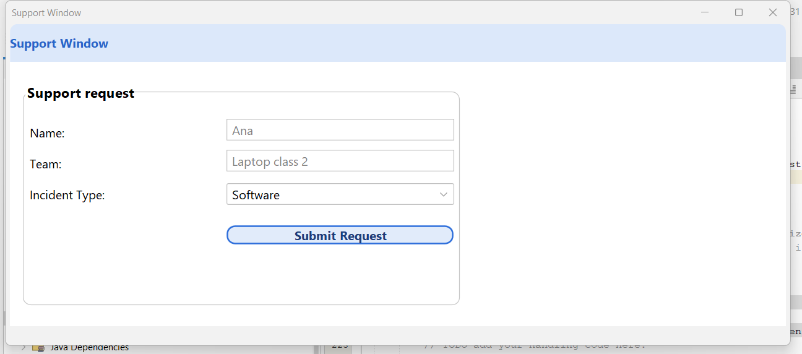
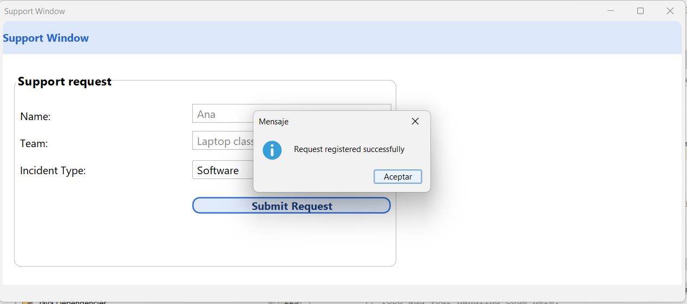

# Support Window

A Java Swing desktop application built with NetBeans for the
*User Interface Generation* module (Unit 1).

## Description

A support request form that lets a user report an issue with a device.
The window includes:

- A rounded title bar ("Support Window")
- A "Support request" panel with rounded borders
- Fields for **Name**, **Team** (device) and **Incident Type**
- A **Submit Request** button with a custom rounded style
- A confirmation message when the request is submitted

## Requirements

- Java JDK 11 or later
- NetBeans IDE

## How to run

1. Open the project in NetBeans (**File → Open Project**).
2. Right-click the project and choose **Clean and Build**.
3. Right-click `VentanaAsistencia.java` and choose **Run File**.
4. Click **Submit Request** to see the confirmation message.

## Screenshots

## Author

Marcelo Alejandro Pérez Guzmán